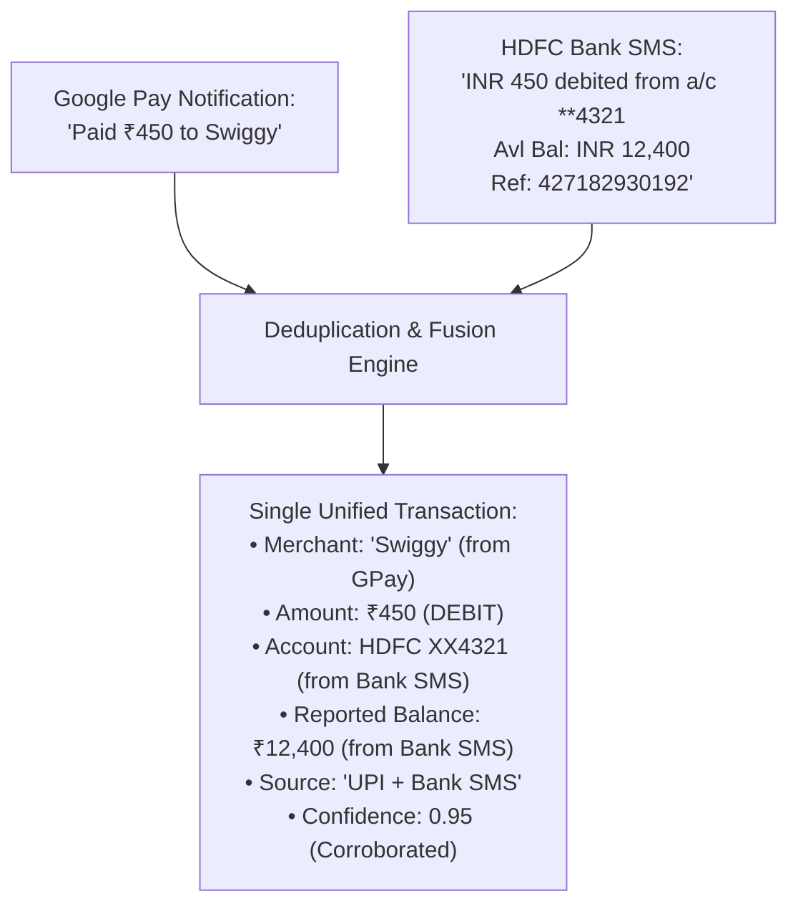

# UPIPulse — Final Implementation Plan & Technical Specification

**UPIPulse** is an India-first personal finance tracking web application designed specifically to convert Indian bank SMS and UPI push notification text into structured, transparent transactions without manual entry.

---

## 1. System Architecture & Processing Pipeline

UPIPulse processes all incoming financial alerts through a strict, deterministic six-stage pipeline:

```text
[Input Alert] 
     │
     ▼
1. Normalize      ── Standardizes whitespace, unicode rupee (₹), currency tokens, and amount formatting
     │
     ▼
2. Pre-Filter     ── Conservatively filters non-transactional alerts (e.g. OTPs, marketing loans)
     │
     ▼
3. Parse          ── Deterministic regex extraction of amount, direction, merchant, account, balance, UTR
     │
     ▼
4. Validate       ── Verifies positive amount, direction, assigns confidence score & parser status
     │
     ▼
5. Dedup & Fuse   ── Multi-level deduplication: L1 (UTR), L2 (Fingerprint), L3 (UPI + Bank SMS Fusion)
     │
     ▼
6. Categorize     ── Rule-based India-focused merchant categorizer (Food, Travel, Shopping, Utilities, etc.)
     │
     ▼
7. Store & Sync   ── Persisted in SQLite with WAL mode; updates "Last reported balance"
```

---

## 2. Ingestion Modes

### Mode A — Manual (Self-Contained)
* Accessible directly from the **Sync & Test** tab in the web UI.
* Paste any raw bank SMS or UPI notification into the Test Bench.
* Runs dry-run parsing, displays confidence score, detected fields, and deduplication prediction.
* Optional one-click **"Save As Transaction"** to commit to the database.

### Mode B — Automated (MacroDroid Background Integration)
* **Trigger**: Android notification received from SMS apps (Google Messages, Samsung Messages) or UPI apps (Google Pay, PhonePe, Paytm, CRED).
* **Action**: MacroDroid sends a background HTTP POST request to:
  ```http
  POST http://<laptop-wi-fi-ip>:3000/api/ingest
  x-api-key: <your-ingestion-key>
  Content-Type: application/json

  {
    "text": "[notification_text]",
    "sender": "[package_name]"
  }
  ```
* Operates seamlessly across local Wi-Fi.

---

## 3. Supported Banks & UPI Coverage (v1)

| Institution / Source | Supported Formats | Extracted Ledger Fields |
| :--- | :--- | :--- |
| **HDFC Bank** | Debit, Credit, UPI transfer, NetBanking, Balance alert | Amount, `XX4321`, VPA/Merchant, Avail Bal, UTR |
| **State Bank of India (SBI)** | Debit, Credit, UPI transfer, Balance alert | Amount, `XX9876`, UPI merchant, Bal, UTR |
| **ICICI Bank** | Merchant debit, Credit, ATM cash withdrawal | Amount, `XX098`, Info merchant, Avail Bal, UTR |
| **Axis Bank** | Debit, Credit, UPI transfer | Amount, `XX5678`, Merchant, Bal, Ref ID |
| **Kotak Mahindra Bank** | Debit, Credit, P2P transfer | Amount, `XX1234`, Payee/Sender, Ref ID |
| **Punjab National Bank (PNB)** | Debit via UPI, Balance alert | Amount, `XX9012`, Avail Bal, Ref ID |
| **Google Pay** | "Paid ₹X to Merchant", "Received ₹X from Sender" | Amount, Direction, Clean Merchant |
| **PhonePe** | "Transaction Successful: Paid ₹X to Merchant" | Amount, Direction, Clean Merchant, Account |
| **Paytm** | "Paid ₹X at Merchant", "Money sent to Payee" | Amount, Direction, Clean Merchant |
| **CRED** | "Payment of ₹X to Merchant successful" | Amount, Direction, Clean Merchant |
| **Generic Fallback** | Fallback regex for standard debit/credit alerts | Amount, Direction, Account Mask, Balance, Ref |

---

## 4. Multi-Level Deduplication & Fusion Strategy

When paying in India via UPI, the user frequently receives **both** a UPI notification (e.g. from Google Pay) and a bank ledger SMS (e.g. from HDFC Bank).



### Deduplication Priority:
1. **Level 1 (Exact UTR / Ref ID Match)**: If reference ID matches an existing transaction within 24 hours:
   - If sources are complementary (`UPI` + `Bank SMS`), fuse fields into one unified transaction.
   - If sources are identical, reject as duplicate (`"Already imported"`).
2. **Level 2 (Candidate Fingerprint)**:
   - Evaluates: `Amount + Type + Account Mask + Merchant Similarity`.
   - Complementary sources within a 10-minute window are safely fused.
3. **Guardrail**:
   - **Never** merge two transactions solely based on `Amount + Time`. Two ₹500 transactions at different merchants or times remain strictly separate.

---

## 5. Database Schema (SQLite)

Located at `data/upipulse.db`:

```sql
PRAGMA foreign_keys = ON;

CREATE TABLE accounts (
  id TEXT PRIMARY KEY,
  bank_name TEXT NOT NULL,
  account_mask TEXT NOT NULL,
  balance REAL NULL,
  balance_updated_at TEXT NULL,
  created_at TEXT NOT NULL,
  updated_at TEXT NOT NULL
);

CREATE TABLE categories (
  id TEXT PRIMARY KEY,
  name TEXT UNIQUE NOT NULL,
  icon TEXT NOT NULL,
  color TEXT NOT NULL,
  monthly_budget REAL DEFAULT 0
);

CREATE TABLE transactions (
  id TEXT PRIMARY KEY,
  amount REAL NOT NULL,
  type TEXT NOT NULL, -- DEBIT, CREDIT, REFUND, TRANSFER, INTERNAL_TRANSFER, UNKNOWN
  merchant TEXT NULL,
  category TEXT NOT NULL DEFAULT 'Other',
  account_id TEXT NULL,
  balance_after REAL NULL,
  ref_id TEXT NULL,
  source TEXT NOT NULL, -- 'UPI', 'Bank SMS', 'UPI + Bank SMS', 'Manual'
  parser_status TEXT NOT NULL, -- 'PARSED', 'NEEDS_REVIEW', 'UNSUPPORTED'
  parser_confidence REAL NOT NULL,
  raw_text TEXT NOT NULL,
  transaction_at TEXT NULL,
  ingested_at TEXT NOT NULL,
  fingerprint TEXT NOT NULL,
  is_internal_transfer INTEGER NOT NULL DEFAULT 0,
  is_deleted INTEGER NOT NULL DEFAULT 0,
  created_at TEXT NOT NULL,
  updated_at TEXT NOT NULL,
  FOREIGN KEY (account_id) REFERENCES accounts(id) ON DELETE SET NULL
);

CREATE TABLE settings (
  id TEXT PRIMARY KEY,
  api_key TEXT NOT NULL,
  monthly_budget_total REAL DEFAULT 35000,
  created_at TEXT NOT NULL,
  updated_at TEXT NOT NULL
);
```

---

## 6. Honest & Transparent UI Principles

1. **"Last reported balance"**: Balances are never called "Live bank balance" because they reflect the latest balance extracted from received bank messages.
2. **"Updated from bank message · [timestamp]"**: Every account card clearly shows when the bank last communicated that balance.
3. **"Needs Review"**: Any transaction with low parser confidence or ambiguous payee is flagged with an amber badge and review prompt.
4. **"View Original Message"**: Every transaction includes an expandable audit drawer displaying the raw SMS/notification text.

---

## 7. Verification Summary

* **Automated Unit Tests**: 54/54 tests passing (`npm test`).
  - Normalization & pre-filtering (OTP/promo rejection).
  - Bank SMS parsers (HDFC, SBI, ICICI, Axis, Kotak, PNB).
  - UPI app parsers (GPay, PhonePe, Paytm, CRED).
  - Deduplication & complementary fusion.
  - Rate limiting & Zod input validation (< 2 KB payload limit).
  - Expense integrity (excluding credits & internal transfers from spending).
* **Build Verification**: Clean production build (`npm run build`) with Next.js 14 App Router and 12 routes generated.
